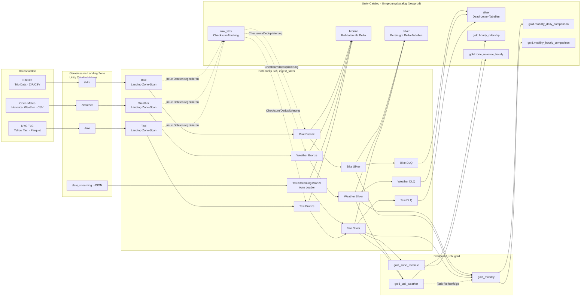

# taxi_showcase

NYC Taxi, Weather & CitiBike Medallion Pipeline – Databricks DABs Project.

## Architecture



`ingest_silver` führt die Weather- und Bike-Quellketten sowie zwei Taxi-
Eingangswege aus. Der Taxi-Batchweg registriert Dateien anhand ihrer Prüfsumme;
Bronze lädt nur noch nicht verarbeitete Dateien. Der separate Taxi-Streaming-
Task liest JSON-Dateien aus `/taxi_streaming` per Auto Loader mit Checkpoint und
`availableNow`. Beide Taxi-Wege schreiben in dieselbe Bronze-Tabelle.
`taxi_silver` läuft, wenn mindestens einer der beiden Taxi-Bronze-Tasks
erfolgreich war, und verarbeitet inkrementell noch nicht in Silver oder der DLQ
repräsentierte Dateien. Silver validiert und bereinigt die Rohdaten und schreibt
nicht verwendbare Datensätze in die jeweilige DLQ-Tabelle. `gold` baut zuerst
`hourly_ridership` aus Taxi und Weather, danach die täglichen/stündlichen
Mobilitätsvergleiche aus Taxi, Bike und Weather sowie `zone_revenue_hourly` aus
Taxi Silver und einer statischen LocationID-Map.

Der Landing-Zone-Volume-Katalog ist zwischen Umgebungen geteilt
(`landing_catalog`, Standard `workspace`). Tracking-, Bronze-, Silver-, DLQ-
und Gold-Tabellen liegen dagegen im Umgebungskatalog (`catalog`: `taxi_dev`
oder `taxi_prod`).

## Structure

```
taxi_showcase/
├── databricks.yml           # Bundle config + targets
├── pyproject.toml           # Wheel build config
├── run_weather_ingress.ps1  # Deploy and run Weather Silver
├── run_bike_ingress.ps1     # Bike pipeline helper
├── run_taxi_pipeline.ps1    # Taxi pipeline helper through Silver
├── taxi_streaming.ps1       # Run Taxi Auto Loader Bronze and Silver
├── run_gold.ps1             # Gold pipeline helper
├── resources/               # Job definitions
│   ├── ingest_silver.job.yml
│   └── gold.job.yml
└── src/taxi_showcase/       # Python package (wheel)
    ├── tracking.py          # Checksum dedup, file tracking
    ├── schema.py            # Schema validation & evolution
    ├── timestamp_utils.py   # Timestamp validation
    ├── ingest_helpers.py    # run_landing_zone_check, verify_bronze
    ├── silver_helpers.py    # Silver checks, DLQ, write_silver
    ├── schemas/            # Expected schemas for all persisted tables
    └── pipelines/          # Pipeline entry points and source schemas
        ├── shared/          # Shared config and tracking schema
        ├── gold/            # Gold-layer analytics pipelines
        ├── weather/         # Pipeline scripts, config.py, and schema.py
        ├── taxi/            # Batch and streaming pipeline scripts, config.py, schema.py
        │   └── zone_lookup.py  # Static TLC LocationID-to-zone map
        └── bike/            # Pipeline scripts, config.py, and schema.py
```

Source schemas and pipeline-specific table/input configuration live alongside
their respective pipelines. Shared pipeline settings, metadata columns, Gold
table names, and the tracking schema live in `pipelines/shared/`. Explicit
contracts for tracking, Bronze, Silver, DLQ, and Gold tables live in
`schemas/`.
The Unity Catalog of each environment is defined by the `catalog` variable per
target in `databricks.yml` (`taxi_dev` / `taxi_prod`) and passed to every
pipeline task as a command-line argument. The landing zone is shared by all
environments and lives in `landing_catalog` (default: `workspace`).

Incoming files and output DataFrames are checked against these contracts, as
are existing tables before use. Schema changes fail the job with the expected
and actual columns or types; automatic Delta schema merging is disabled. To
adopt an intentional source change, update the corresponding contract and
transformation together.

Weather Bronze and DLQ preserve the original Open-Meteo CSV headers, which
include spaces and special characters. Their Delta tables are created with
name-based column mapping to support those names. Weather Silver renames the
measurements to normalized analytical columns such as `temperature_2m_c` and
`rain_mm`.

Silver event timestamps use `timestamp_ntz` consistently for local taxi, bike,
and weather times. Bronze retains the source timestamp types; Bike timestamps
are cast from `timestamp` to `timestamp_ntz` in Silver, while Weather strings
are parsed directly as `timestamp_ntz`. Processing metadata such as
`_ingested_at` remains `timestamp`.

## Deploy

Python 3.10 or newer must be installed and available as `python` on your `PATH`.
The jobs use Databricks serverless compute and require a workspace that supports serverless jobs.
Targets: `dev` (catalog `taxi_dev`, default) and `prod` (catalog `taxi_prod`,
`mode: production`). Both catalogs must exist before the first run
(`CREATE CATALOG IF NOT EXISTS taxi_dev;`); schemas and tables are created by
the pipelines. Deploy production with `--target prod`.

```bash
databricks auth login --host https://dbc-b5503989-0919.cloud.databricks.com --profile DEFAULT
# Validate
databricks bundle validate --target dev

# Deploy
databricks bundle deploy --target dev

# Run a job
databricks bundle run ingest_silver --target dev

# Run the full Gold job (Silver tables must already exist)
databricks bundle run gold --target dev

# Run pipeline helpers from PowerShell
.\run_weather_ingress.ps1
.\run_bike_ingress.ps1
.\run_taxi_pipeline.ps1
.\taxi_streaming.ps1
.\run_gold.ps1
```

The Taxi batch helper runs `taxi_landing_zone`, `taxi_bronze`, and `taxi_silver`
in sequence. If no files are pending for batch Bronze, it skips Bronze and
Silver unless `-Force` or `-FullRefresh` is given. Taxi Silver runs
incrementally by default when its Silver table already exists; use
`.\run_taxi_pipeline.ps1 -FullRefresh` to rebuild Silver and its DLQ from all
Bronze rows.

The separate `.\taxi_streaming.ps1` helper deploys the bundle and runs
`taxi_streaming_bronze` followed by `taxi_silver`. Auto Loader reads JSON files
from `/taxi_streaming`; its checkpoint tracks processed files, and
`availableNow` processes currently available input before the task stops. This
path does not use the batch checksum tracking or pending-file skip. Streaming
and batch both append to `<catalog>.bronze.taxi_trips_raw`; Silver then picks
up unprocessed source files incrementally. The Bike helper runs
`bike_landing_zone`, `bike_bronze`, and `bike_silver` in sequence. The Gold
helper deploys the bundle and runs the `gold` job. `gold_mobility` runs after
`gold_taxi_weather`; `gold_zone_revenue` is independent and may run in
parallel. The Gold helper does not run upstream ingestion or Silver jobs, so
run those first when their tables need refreshing.

The Weather helper deploys the bundle and runs only `weather_silver`; it
expects the Weather Bronze table to exist already. To run the complete Weather
chain, use `ingest_silver` or run each step with the `--only` selector:

```powershell
databricks bundle run ingest_silver --only weather_landing_zone --target dev
databricks bundle run ingest_silver --only weather_bronze --target dev
databricks bundle run ingest_silver --only weather_silver --target dev
```

The static NYC TLC LocationID map in `pipelines/taxi/zone_lookup.py` was
generated from `taxi_zone_lookup.csv` and includes Borough, Zone, and
service_zone for IDs 1–265. The `gold_zone_revenue` task reads
`<catalog>.silver.taxi_trips` only, enriches `PULocationID` from this map, and
does not depend on Weather or another Gold table. It filters out rows without a
pickup location or with non-positive `total_amount`, then writes
`<catalog>.gold.zone_revenue_hourly`, partitioned by `pickup_date`.

## Processing model and scaling

Batch Landing Zone → Bronze is incremental: files with an unseen checksum are
registered, and Bronze loads tracked files not yet present in the Bronze table.
The Taxi streaming path independently uses Auto Loader's checkpoint to find
new JSON files and appends them to the same Taxi Bronze table. Taxi Silver is
incremental by default when a Silver table already exists: it processes Bronze
files not yet represented in Silver or the DLQ, deduplicates against existing
trips, and appends new results. On the first run, when Silver does not yet
exist, it performs a full refresh. Use `.\run_taxi_pipeline.ps1 -FullRefresh`
or pass `--full-refresh` to the `taxi_silver` task to rebuild Taxi Silver and
its DLQ from all Bronze rows.

Bike and Weather Silver, along with Gold outputs, remain full refreshes: they
read their complete upstream tables and overwrite their targets. This keeps
those pipelines simple and is sufficient for a few months of data. Mobility
Gold skips its writes if any Taxi, Bike, or Weather Silver source is missing or
empty, preserving existing Gold results in that case.

Adding newer data works by placing batch files in the corresponding landing
zone (Taxi `/taxi`) or streaming JSON files in `/taxi_streaming`, then running
the matching ingestion helper and the Gold job. Bronze registers or discovers
and appends new files; Taxi Silver appends their unprocessed trips, while
Bike/Weather Silver and Gold are recomputed from their complete upstream
tables. For older backfills or source corrections, run Taxi Silver with
`--full-refresh` after loading the files. Checks to keep in mind:

- The temporal outlier filter derives its lower bound from the data
  (5th percentile − 30 days) during full Taxi refreshes and Bike processing.
  Incremental Taxi runs use the existing Silver minimum pickup time − 100 days.
  Backfills earlier than the applicable lower bound are moved to the DLQ, so
  older historical data may need a deliberate outlier-policy adjustment.
- Weather must cover the same period, otherwise the new trips have no weather
  match (see the coverage output of `gold_taxi_weather`).

The cost of full refreshes grows with total history, not with new data. In
incremental Taxi Silver, the outlier filter uses a fixed lower bound from the
existing Silver data (minimum pickup − 100 days; a small batch is not a sound
basis for percentiles). Trips already in Silver (all source columns equal,
null-safe) are recorded in the DLQ as `duplicate`. Taxi data has no trip ID, so
identical source records are treated as the same trip.

The landing-zone check no longer re-hashes the whole landing zone: tracked files
with unchanged name and size reuse their stored checksum. To scale further to
continuous operation:

- **Further incremental Silver:** Bike and Weather Silver still read their
  complete Bronze tables. They could process only new Bronze rows (using
  `_ingested_at` or new `_source_file` values, not event time, so late or
  historical backfills are picked up) and `MERGE` by a suitable business key.
- **Incremental Gold:** recompute only the affected days/hours and replace
  them with `MERGE` or `replaceWhere`.
- **Layout:** Liquid Clustering (or partitioning) on the pickup date/hour so
  that reads and updates touch only the relevant files.
- **Ingestion:** Taxi already has an Auto Loader path for JSON files in
  `/taxi_streaming`; it can be extended to other sources. Auto Loader or
  `COPY INTO` could replace checksum scans for the remaining batch pipelines.

## Code quality

GitHub Actions runs Ruff and the unit tests on every push and pull request.
To run the same checks automatically before each commit, install the
development tools and enable the Git hook:

```powershell
python -m pip install -e ".[dev]"
pre-commit install
```

The pre-commit hook runs `ruff check src tests` and the complete unit-test
suite. Run these checks manually with:

```powershell
ruff check src tests
python tests/run_tests.py
```

## Unity Catalog

Tables use the environment catalog configured per target by `catalog` in
`databricks.yml` (`taxi_dev` or `taxi_prod`):
- `<catalog>.raw_files.*` — tracking tables
- `<catalog>.bronze.*` — raw data
- `<catalog>.silver.*` — cleaned data + DLQ
- `<catalog>.gold.*` — analytics tables

The landing-zone Volume `<landing_catalog>.raw_files.landing_zone`
(default: `workspace`) is shared by dev and prod.
