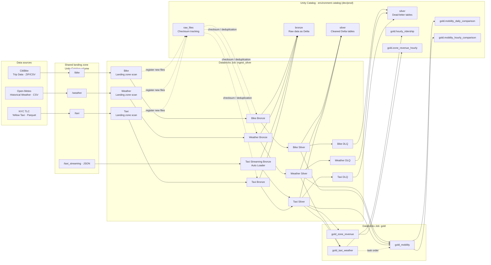
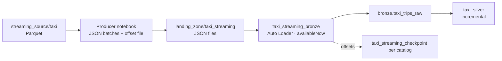

# taxi_showcase

NYC Taxi, Weather & CitiBike Medallion Pipeline – Databricks DABs Project.

## Architecture



`ingest_silver` runs the Weather and Bike source chains and two Taxi input
paths. Each batch chain scans its landing zone, registers files by checksum,
and loads only files that are not yet in Bronze; a condition task skips Bronze
and Silver when the landing zone reports no pending files. The separate Taxi
streaming task reads JSON files from `/taxi_streaming` with Auto Loader, a
checkpoint, and the `availableNow` trigger. Both Taxi paths write to the same
Bronze table. `taxi_silver` runs when at least one of the two Taxi Bronze tasks
succeeded and incrementally processes files that are not yet represented in
Silver or the DLQ. Silver validates and cleans the raw data and writes unusable
records to the corresponding DLQ table. `gold` first builds `hourly_ridership`
from Taxi and Weather, then the daily and hourly mobility comparisons from Taxi,
Bike, and Weather, and `zone_revenue_hourly` from Taxi Silver and a static
LocationID map.

The landing-zone volume catalog is shared by all environments
(`landing_catalog`, default `workspace`). Tracking, Bronze, Silver, DLQ, and
Gold tables live in the environment catalog (`catalog`: `taxi_dev` or
`taxi_prod`).

## Structure

```
taxi_showcase/
├── databricks.yml           # Bundle config + targets
├── pyproject.toml           # Wheel build config and dev dependencies
├── .pre-commit-config.yaml  # Pre-commit hooks (Ruff, unit tests)
├── run_weather_ingress.ps1  # Deploy and run the full Weather chain
├── run_bike_ingress.ps1     # Bike pipeline helper
├── run_taxi_pipeline.ps1    # Taxi pipeline helper through Silver
├── taxi_streaming.ps1       # Run Taxi Auto Loader Bronze and Silver
├── run_gold.ps1             # Gold pipeline helper
├── resources/               # Job definitions
│   ├── ingest_silver.job.yml
│   └── gold.job.yml
├── tests/                   # Unit tests (run_tests.py runs the suite)
└── src/taxi_showcase/       # Python package (wheel)
    ├── tracking.py          # Checksum dedup, file tracking
    ├── schema.py            # Schema validation & evolution
    ├── timestamp_utils.py   # Timestamp validation
    ├── ingest_helpers.py    # run_landing_zone_check, verify_bronze
    ├── silver_helpers.py    # Silver checks, DLQ, write_silver
    ├── schemas/            # Expected schemas for all persisted tables
    └── pipelines/          # Pipeline entry points and source schemas
        ├── shared/          # Shared config and tracking schema
        ├── gold/            # Gold-layer analytics pipelines
        ├── weather/         # Pipeline scripts, config.py, and schema.py
        ├── taxi/            # Batch and streaming pipeline scripts, config.py, schema.py
        │   └── zone_lookup.py  # Static TLC LocationID-to-zone map
        └── bike/            # Pipeline scripts, config.py, and schema.py
```

Source schemas and pipeline-specific table/input configuration live alongside
their respective pipelines. Shared pipeline settings, metadata columns, Gold
table names, and the tracking schema live in `pipelines/shared/`. Explicit
contracts for tracking, Bronze, Silver, DLQ, and Gold tables live in
`schemas/`.
The Unity Catalog of each environment is defined by the `catalog` variable per
target in `databricks.yml` (`taxi_dev` / `taxi_prod`) and passed to every
pipeline task as a command-line argument. The landing zone is shared by all
environments and lives in `landing_catalog` (default: `workspace`).

Incoming files and output DataFrames are checked against these contracts, as
are existing tables before use. Schema changes fail the job with the expected
and actual columns or types; automatic Delta schema merging is disabled. To
adopt an intentional source change, update the corresponding contract and
transformation together.

Weather Bronze and DLQ preserve the original Open-Meteo CSV headers, which
include spaces and special characters. Their Delta tables are created with
name-based column mapping to support those names. Weather Silver renames the
measurements to normalized analytical columns such as `temperature_2m_c` and
`rain_mm`.

Silver event timestamps use `timestamp_ntz` consistently for local taxi, bike,
and weather times. Bronze retains the source timestamp types; Bike timestamps
are cast from `timestamp` to `timestamp_ntz` in Silver, while Weather strings
are parsed directly as `timestamp_ntz`. Processing metadata such as
`_ingested_at` remains `timestamp`.

## Deploy

Python 3.10 or newer must be installed and available as `python` on your `PATH`.
The jobs use Databricks serverless compute and require a workspace that supports serverless jobs.
Targets: `dev` (catalog `taxi_dev`, default) and `prod` (catalog `taxi_prod`,
`mode: production`). Both catalogs must exist before the first run
(`CREATE CATALOG IF NOT EXISTS taxi_dev;`); schemas and tables are created by
the pipelines. Deploy production with `--target prod`.

```bash
databricks auth login --host https://dbc-b5503989-0919.cloud.databricks.com --profile DEFAULT
# Validate
databricks bundle validate --target dev

# Deploy
databricks bundle deploy --target dev

# Run a job
databricks bundle run ingest_silver --target dev

# Run the full Gold job (Silver tables must already exist)
databricks bundle run gold --target dev

# Run pipeline helpers from PowerShell
.\run_weather_ingress.ps1
.\run_bike_ingress.ps1
.\run_taxi_pipeline.ps1
.\taxi_streaming.ps1
.\run_gold.ps1
```

The Taxi batch helper runs `taxi_landing_zone`, `taxi_bronze`, and `taxi_silver`
in sequence. If no files are pending for batch Bronze, it skips Bronze and
Silver unless `-Force` or `-FullRefresh` is given. Taxi Silver runs
incrementally by default when its Silver table exists; use
`.\run_taxi_pipeline.ps1 -FullRefresh` to rebuild Silver and its DLQ from all
Bronze rows.

The `.\taxi_streaming.ps1` helper deploys the bundle and runs
`taxi_streaming_bronze` followed by `taxi_silver`. Auto Loader reads JSON files
from `/taxi_streaming`; its checkpoint tracks processed files, and
`availableNow` processes all currently available input before the task stops.
This path does not use the batch checksum tracking or the pending-file check.
Streaming and batch both append to `<catalog>.bronze.taxi_trips_raw`; Silver
then picks up unprocessed source files incrementally.

The Bike helper runs `bike_landing_zone`, `bike_bronze`, and `bike_silver` in
sequence, skipping Bronze and Silver when no files are pending unless `-Force`
is given. The Weather helper deploys the bundle and runs `weather_landing_zone`,
`weather_bronze`, and `weather_silver` in sequence. The Gold helper deploys the
bundle and runs the `gold` job. `gold_mobility` runs after `gold_taxi_weather`;
`gold_zone_revenue` is independent and may run in parallel. The Gold helper does
not run upstream ingestion or Silver jobs, so run those first when their tables
need refreshing.

Individual tasks of `ingest_silver` can be run with the `--only` selector, for
example:

```powershell
databricks bundle run ingest_silver --only weather_landing_zone --target dev
databricks bundle run ingest_silver --only weather_bronze --target dev
databricks bundle run ingest_silver --only weather_silver --target dev
```

The static NYC TLC LocationID map in `pipelines/taxi/zone_lookup.py` was
generated from `taxi_zone_lookup.csv` and includes Borough, Zone, and
service_zone for IDs 1–265. The `gold_zone_revenue` task reads
`<catalog>.silver.taxi_trips` only, enriches `PULocationID` from this map, and
does not depend on Weather or another Gold table. It filters out rows without a
pickup location or with non-positive `total_amount`, then writes
`<catalog>.gold.zone_revenue_hourly`, partitioned by `pickup_date`.

## Taxi streaming path

The streaming path simulates a message-based source such as a Kafka topic with
files. A producer notebook writes small JSON files into a directory, and an
Auto Loader consumer task in the `ingest_silver` job reads them incrementally.

| Kafka concept | Implementation |
|---------------|----------------|
| Topic | `/Volumes/<landing_catalog>/raw_files/landing_zone/taxi_streaming/` |
| Producer | Databricks notebook `Taxi Streaming Producer` (run manually, not part of the bundle) |
| Message batch | One JSON file with up to 10,000 trip records |
| Consumer and offsets | Auto Loader task `taxi_streaming_bronze` with a checkpoint |



**Producer.** The notebook reads Parquet files from a separate source volume
(`/Volumes/workspace/raw_files/streaming_source/taxi`), kept apart from the
batch landing zone so that both approaches stay independent. Each run sends the
next `BATCH_SIZE × MAX_BATCHES` records (default 10,000 × 10) and writes them as
files named `<yyyymmdd_HHMMSS>_batch_<nnnn>.json`, with a short delay between
files to mimic live data. Spark writes each batch as a directory containing a
single part file, which Auto Loader discovers recursively. The number of
records already sent is kept in the offset file `.producer_offset` next to the
source data, so every run continues where the previous one stopped. When all
records are sent, the notebook reports that no new data is available. Deleting
the offset file restarts the producer from the first record.

**Consumer.** `taxi_streaming_bronze`
([streaming_bronze.py](src/taxi_showcase/pipelines/taxi/streaming_bronze.py))
reads the directory with `cloudFiles` (JSON) and the same column contract as
the batch path (`EXPECTED_COLUMNS`). It adds `_source_file` and `_ingested_at`
and appends to `<catalog>.bronze.taxi_trips_raw`. The checkpoint at
`<landing zone>/taxi_streaming_checkpoint/<catalog>` records which files were
processed, so each environment tracks its own progress and a rerun only loads
new files. The `availableNow` trigger processes everything currently available
and then stops, so the task fits into a scheduled job instead of running
continuously. Deleting the checkpoint makes the consumer reload all files.

**Interaction with the batch path.**
- Streaming and batch both append to the same Bronze table and use their own
  mechanism to avoid reloading files: the checkpoint for streaming, checksum
  tracking for batch.
- `taxi_streaming_bronze` has no upstream task and runs in parallel to the batch
  chain. It does not use the pending-file condition, so it runs on every job
  run.
- `taxi_silver` starts when at least one Taxi Bronze task succeeded and
  processes only source files that are not yet in Silver or the DLQ. Trips that
  already exist in Silver are recorded in the DLQ as `duplicate`, so
  redelivered records do not create duplicates.

**Run it.**
1. Run the producer notebook in the workspace to write a new set of JSON files.
2. Run `.\taxi_streaming.ps1`, or run the full `ingest_silver` job. Both load
   the new files into Bronze and update Silver.

## Processing model and scaling

Batch landing zone → Bronze is incremental: files with an unseen checksum are
registered, and Bronze loads tracked files that are not yet present in the
Bronze table. A tracked file that is missing from the landing zone is skipped
with a warning and stays pending until its tracking entry is removed. The Taxi
streaming path independently uses the Auto Loader checkpoint to find new JSON
files and appends them to the same Taxi Bronze table. Taxi Silver is
incremental when its Silver table exists: it processes Bronze files that are
not yet represented in Silver or the DLQ, deduplicates against existing trips,
and appends the new results. Without a Silver table, the first run is a full
refresh. Use `.\run_taxi_pipeline.ps1 -FullRefresh` or pass `--full-refresh` to
the `taxi_silver` task to rebuild Taxi Silver and its DLQ from all Bronze rows.

Bike and Weather Silver and all Gold outputs are full refreshes: they read their
complete upstream tables and overwrite their targets, which is sufficient for a
few months of data. `gold_mobility` fails if a Taxi, Bike, or Weather Silver
table does not exist. If any of them is empty, it skips its writes and keeps
the existing Gold results. `gold_taxi_weather` skips its write when there are
no trips or no trip matches a weather observation, and `gold_zone_revenue`
skips its write when there are no valid Taxi trips.

To add data, place batch files in the matching landing zone folder (Taxi
`/taxi`) or streaming JSON files in `/taxi_streaming`, then run the matching
ingestion helper and the Gold job. Bronze registers or discovers and appends
the new files; Taxi Silver appends their unprocessed trips, while Bike/Weather
Silver and Gold are recomputed from their complete upstream tables. For older
backfills or source corrections, run Taxi Silver with `--full-refresh` after
loading the files. Points to keep in mind:

- The temporal outlier filter accepts timestamps up to the current date. Its
  lower bound is derived from the data (5th percentile − 30 days) in full Taxi
  refreshes and in Bike processing. Incremental Taxi runs use a fixed lower
  bound of the existing Silver minimum pickup time − 100 days, because a small
  batch is not a sound basis for percentiles. Rows outside the applicable range
  are moved to the DLQ, so older historical data may need a deliberate
  outlier-policy adjustment.
- Weather must cover the same period as the trips, otherwise the trips have no
  weather match (see the coverage output of `gold_taxi_weather`).
- Trips already in Silver (all source columns equal, null-safe) are recorded
  in the DLQ as `duplicate`. Taxi data has no trip ID, so identical source
  records are treated as the same trip.

The cost of full refreshes grows with total history, not with new data. The
landing-zone check does not re-hash the whole landing zone: tracked files with
unchanged name and size reuse their stored checksum. Options to scale to
continuous operation:

- **Incremental Silver for Bike and Weather:** they could process only new
  Bronze rows (using `_ingested_at` or new `_source_file` values, not event
  time, so late or historical backfills are picked up) and `MERGE` by a
  suitable business key.
- **Incremental Gold:** recompute only the affected days/hours and replace
  them with `MERGE` or `replaceWhere`.
- **Layout:** Liquid Clustering (or partitioning) on the pickup date/hour so
  that reads and updates touch only the relevant files.
- **Ingestion:** the Taxi Auto Loader path for JSON files in `/taxi_streaming`
  can be extended to other sources. Auto Loader or `COPY INTO` could replace
  checksum scans for the batch pipelines.

## Sample data

The `dev` environment is loaded with these source files (landing zone volume
`workspace.raw_files.landing_zone`):

| Source | Folder | Files |
|--------|--------|-------|
| NYC TLC Yellow Taxi (batch) | `/taxi` | `yellow_tripdata_2026-08.parquet` |
| NYC TLC Yellow Taxi (streaming) | `/taxi_streaming` | JSON batches written by the producer notebook, read by Auto Loader |
| Open-Meteo weather | `/weather` | `2026_07_…W2m.csv`, `2026_08_…W51m.csv` (hourly, 2026-07-01 to 2026-08-31) |
| CitiBike trips | `/bike` | `202607-citibike-tripdata.zip`, `202608-citibike-tripdata.zip` |

`taxi_dev.bronze.taxi_trips_raw` holds 4,461,716 rows from both Taxi paths, and
`taxi_dev.silver.weather_hourly` holds 1,488 hourly rows (62 complete days).

## Code quality

GitHub Actions runs Ruff and the unit tests on every push and pull request.
To run the same checks automatically before each commit, install the
development tools and enable the Git hook:

```powershell
python -m pip install -e ".[dev]"
pre-commit install
```

The pre-commit hook runs `ruff check src tests` and the complete unit-test
suite. Run these checks manually with:

```powershell
ruff check src tests
python tests/run_tests.py
```

## Unity Catalog

Tables use the environment catalog configured per target by `catalog` in
`databricks.yml` (`taxi_dev` or `taxi_prod`):
- `<catalog>.raw_files.*` — tracking tables
- `<catalog>.bronze.*` — raw data
- `<catalog>.silver.*` — cleaned data + DLQ
- `<catalog>.gold.*` — analytics tables

The landing-zone Volume `<landing_catalog>.raw_files.landing_zone`
(default: `workspace`) is shared by dev and prod.
