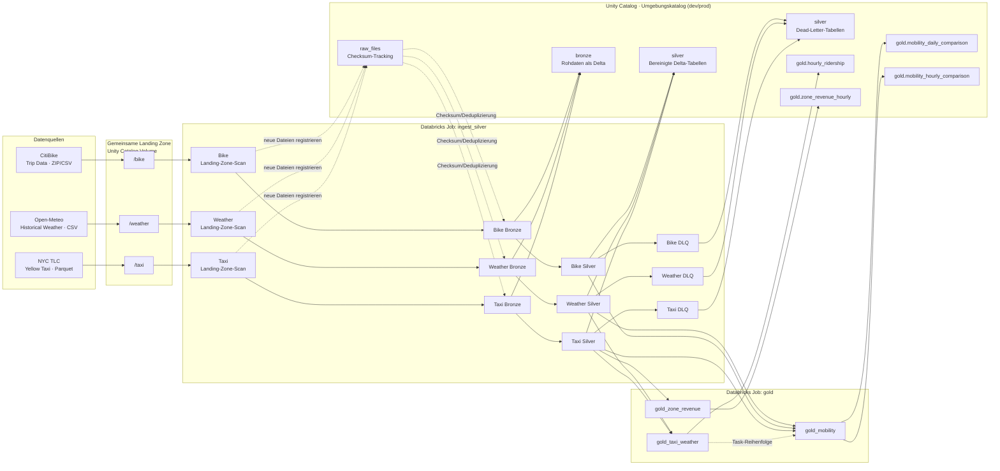

# taxi_showcase

NYC Taxi, Weather & CitiBike Medallion Pipeline – Databricks DABs Project.

## Architecture



`ingest_silver` führt die drei Quellketten unabhängig voneinander aus. Die
Landing-Zone-Schritte registrieren neue Dateien anhand ihrer Prüfsumme; Bronze
lädt anschließend nur noch nicht verarbeitete Dateien. Silver validiert und
bereinigt die Rohdaten und schreibt nicht verwendbare Datensätze in die
jeweilige DLQ-Tabelle. `gold` baut zuerst `hourly_ridership` aus Taxi und
Weather, danach die täglichen/stündlichen Mobilitätsvergleiche aus Taxi, Bike
und Weather sowie `zone_revenue_hourly` aus Taxi Silver und einer statischen
LocationID-Map.

Der Landing-Zone-Volume-Katalog ist zwischen Umgebungen geteilt
(`landing_catalog`, Standard `workspace`). Tracking-, Bronze-, Silver-, DLQ-
und Gold-Tabellen liegen dagegen im Umgebungskatalog (`catalog`: `taxi_dev`
oder `taxi_prod`).

## Structure

```
taxi_showcase/
├── databricks.yml           # Bundle config + targets
├── pyproject.toml           # Wheel build config
├── run_weather_ingress.ps1  # Deploy and run Weather Silver
├── run_bike_ingress.ps1     # Bike pipeline helper
├── run_taxi_pipeline.ps1    # Taxi pipeline helper through Silver
├── run_gold.ps1             # Gold pipeline helper
├── resources/               # Job definitions
│   ├── ingest_silver.job.yml
│   └── gold.job.yml
└── src/taxi_showcase/       # Python package (wheel)
    ├── tracking.py          # Checksum dedup, file tracking
    ├── schema.py            # Schema validation & evolution
    ├── timestamp_utils.py   # Timestamp validation
    ├── ingest_helpers.py    # run_landing_zone_check, verify_bronze
    ├── silver_helpers.py    # Silver checks, DLQ, write_silver
    ├── schemas/            # Expected schemas for all persisted tables
    └── pipelines/          # Pipeline entry points and source schemas
        ├── shared/          # Shared config and tracking schema
        ├── gold/            # Gold-layer analytics pipelines
        ├── weather/         # Pipeline scripts, config.py, and schema.py
        ├── taxi/            # Pipeline scripts, config.py, and schema.py
        │   └── zone_lookup.py  # Static TLC LocationID-to-zone map
        └── bike/            # Pipeline scripts, config.py, and schema.py
```

Source schemas and pipeline-specific table/input configuration live alongside
their respective pipelines. Shared pipeline settings, metadata columns, Gold
table names, and the tracking schema live in `pipelines/shared/`. Explicit
contracts for tracking, Bronze, Silver, DLQ, and Gold tables live in
`schemas/`.
The Unity Catalog of each environment is defined by the `catalog` variable per
target in `databricks.yml` (`taxi_dev` / `taxi_prod`) and passed to every
pipeline task as a command-line argument. The landing zone is shared by all
environments and lives in `landing_catalog` (default: `workspace`).

Incoming files and output DataFrames are checked against these contracts, as
are existing tables before use. Schema changes fail the job with the expected
and actual columns or types; automatic Delta schema merging is disabled. To
adopt an intentional source change, update the corresponding contract and
transformation together.

Weather Bronze and DLQ preserve the original Open-Meteo CSV headers, which
include spaces and special characters. Their Delta tables are created with
name-based column mapping to support those names. Weather Silver renames the
measurements to normalized analytical columns such as `temperature_2m_c` and
`rain_mm`.

Silver event timestamps use `timestamp_ntz` consistently for local taxi, bike,
and weather times. Bronze retains the source timestamp types; Bike timestamps
are cast from `timestamp` to `timestamp_ntz` in Silver, while Weather strings
are parsed directly as `timestamp_ntz`. Processing metadata such as
`_ingested_at` remains `timestamp`.

## Deploy

Python 3.10 or newer must be installed and available as `python` on your `PATH`.
The jobs use Databricks serverless compute and require a workspace that supports serverless jobs.
Targets: `dev` (catalog `taxi_dev`, default) and `prod` (catalog `taxi_prod`,
`mode: production`). Both catalogs must exist before the first run
(`CREATE CATALOG IF NOT EXISTS taxi_dev;`); schemas and tables are created by
the pipelines. Deploy production with `--target prod`.

```bash
databricks auth login --host https://dbc-b5503989-0919.cloud.databricks.com --profile DEFAULT
# Validate
databricks bundle validate --target dev

# Deploy
databricks bundle deploy --target dev

# Run a job
databricks bundle run ingest_silver --target dev

# Run the full Gold job (Silver tables must already exist)
databricks bundle run gold --target dev

# Run pipeline helpers from PowerShell
.\run_weather_ingress.ps1
.\run_bike_ingress.ps1
.\run_taxi_pipeline.ps1
.\run_gold.ps1
```

The Taxi helper runs `taxi_landing_zone`, `taxi_bronze`, and `taxi_silver`
in sequence. The Bike helper runs `bike_landing_zone`, `bike_bronze`, and
`bike_silver` in sequence. The Gold helper deploys the
bundle and runs the `gold` job, which builds `gold_taxi_weather` followed by
`gold_mobility` and `gold_zone_revenue`. It does not run the upstream ingestion
or Silver jobs, so run those first when their tables need to be refreshed.

The Weather helper deploys the bundle and runs `weather_landing_zone`,
`weather_bronze`, and `weather_silver` in sequence. To run an individual
Weather step manually, use the `ingest_silver` job with the `--only` selector:

```powershell
databricks bundle run ingest_silver --only weather_landing_zone --target dev
databricks bundle run ingest_silver --only weather_bronze --target dev
databricks bundle run ingest_silver --only weather_silver --target dev
```

The static NYC TLC LocationID map in `pipelines/taxi/zone_lookup.py` was
generated from `taxi_zone_lookup.csv` and includes Borough, Zone, and
service_zone for IDs 1–265. The `gold_zone_revenue` task reads
`<catalog>.silver.taxi_trips` only, enriches `PULocationID` from this map, and
does not depend on Weather or another Gold table. It filters out rows without a
pickup location or with non-positive `total_amount`, then writes
`<catalog>.gold.zone_revenue_hourly`, partitioned by `pickup_date`.

## Processing model and scaling

Landing Zone → Bronze is incremental: only files with an unseen checksum are
registered and appended. Silver and Gold are deliberately **full refresh**:
each run reads the complete upstream table and overwrites its targets
(`write_table(..., mode="overwrite")`, including the DLQ tables). This keeps
the jobs simple and idempotent and is sufficient for a few months of data.

Adding older data later (e.g. February after August is loaded) works without
code changes: drop the Taxi and Weather files for the new period into the
landing zone, then run `ingest_silver` and `gold`. Bronze appends the new
files, and the full refresh recomputes Silver and Gold over all months.
Checks to keep in mind:

- The temporal outlier filter derives its lower bound from the data
  (5th percentile − 30 days). A backfill that makes up less than ~5% of all
  rows would be classified as outliers and moved to the DLQ; a month-sized
  backfill is fine.
- Weather must cover the same period, otherwise the new trips have no weather
  match (see the coverage output of `gold_taxi_weather`).

The cost of a full refresh grows with total history, not with new data. To
scale to continuous operation:

- **Incremental Silver:** process only new Bronze rows (watermark on
  `_ingested_at` or the new `_source_file` values, not on the event time, so
  late or historical backfills are picked up) and `MERGE` them by business
  key (Bike `ride_id`, Weather `ts`, Taxi: all source columns).
- **Incremental Gold:** recompute only the affected days/hours and replace
  them with `MERGE` or `replaceWhere`.
- **Layout:** Liquid Clustering (or partitioning) on the pickup date/hour so
  that reads and updates touch only the relevant files.
- **Ingestion:** Auto Loader / `COPY INTO` replaces the checksum scan, and a
  streaming source (e.g. CitiBike real-time feed) can feed Bronze directly.

## Code quality

GitHub Actions runs Ruff and the unit tests on every push and pull request.
To run the same lint check locally:

```bash
python -m pip install ruff
ruff check src tests
```

Run the schema validation unit tests with:

```powershell
$env:PYTHONPATH = "src"
python -m unittest discover -s tests -v
```

## Unity Catalog

Tables use the environment catalog configured per target by `catalog` in
`databricks.yml` (`taxi_dev` or `taxi_prod`):
- `<catalog>.raw_files.*` — tracking tables
- `<catalog>.bronze.*` — raw data
- `<catalog>.silver.*` — cleaned data + DLQ
- `<catalog>.gold.*` — analytics tables

The landing-zone Volume `<landing_catalog>.raw_files.landing_zone`
(default: `workspace`) is shared by dev and prod.
